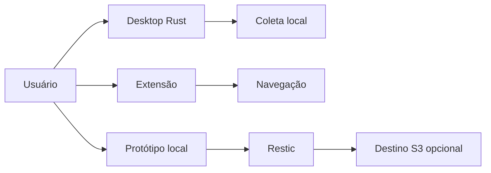

# Modelo de ameaças da Central de diagnóstico

## Resumo executivo

As fronteiras principais são o computador local, as permissões da extensão e o destino de backup. O desktop em Rust reduz a dependência de um servidor HTTP para a auditoria básica. O protótipo legado continua com operações locais que exigem proteção própria. A distribuição assinada e a proteção das credenciais são condições para ampliar o uso.

## Escopo e premissas

Este modelo cobre `desktop`, `agente`, `extension`, o protótipo `server.mjs`, `backup` e os controles presentes no protótipo `portal`. O primeiro lançamento é local em Windows sob usuário comum. O portal está adiado. Controles corporativos, resposta remota e IA executando ações são integrações futuras cujo desenho exige nova revisão.

## Modelo do sistema e limites de confiança

| Fronteira | Dados e controle observado |
| --- | --- |
| Desktop → sistema | Operação de auditoria de leitura, identificadores de verificações, estado e orientação. `agente/src/lib.rs` consulta fontes locais com argumentos fixos. |
| Navegador → protótipo | HTTP restrito a loopback. Host, Origin e token de sessão são exigidos para POST. Operações de arquivo e backup têm limites explícitos de entrada. |
| Extensão → navegação | Regras declarativas com permissão de hosts, configuradas pelo usuário no perfil, e redirecionamento para aviso local. |
| Protótipo → restic | Processos sem shell, caminho de executável resolvido, senha fornecida ao subprocesso e destino S3 HTTPS fixado pelo operador. |
| Portal → Supabase | Autenticação e políticas de linha por conta no protótipo. A instalação de produção e a autenticação real ainda exigem testes. |

## Ativos, ameaças e ações

O modelo considera páginas externas maliciosas, arquivos não confiáveis, contas indevidas no portal e processos locais de outras origens. Uma máquina já comprometida na conta do usuário pode ler dados disponíveis para essa conta. As garantias dependem do isolamento e da integridade do sistema operacional.

| ID | Risco e impacto | Controle presente | Lacuna ou critério de aceite | Prioridade |
| --- | --- | --- | --- | --- |
| TM-001 | Página externa dispara ação local e consome recursos ou muda dados | Loopback, Host, Origin, token e limites em `server.mjs` | Testar rejeição por origem e token em todas as rotas mutáveis. Manter a auditoria nativa fora dessa superfície. | média |
| TM-002 | Arquivo malformado excede limites ou explora o verificador | Triagem em memória e limite de tamanho. Motor real externo no Linux | Atualizar o motor, testar falhas e aplicar isolamento antes de ampliar cobertura. | alta |
| TM-003 | Destino incorreto, senha ou credenciais expostas compromete backup | Senha independente, restic criptografa, S3 fixado e opt-in | Testar bucket de homologação, rotação, restauração e permissões mínimas. Evitar registro de segredos. | alta |
| TM-004 | Alteração de regras ou artefatos induz falso negativo ou instalação comprometida | Regras locais declarativas, dependências com lockfiles | Assinar instalador, verificar atualização e auditar dependências antes da distribuição. | alta |
| TM-005 | Resumo de outro dispositivo acessado por conta indevida | RLS e vínculo entre dispositivo e diagnóstico testado em PostgreSQL local | Validar provedor real e autenticação com duas contas antes de publicar o portal. | média enquanto adiado |
| TM-006 | Resultado técnico é entendido como comprovação de segurança | A UI apresenta estado por verificação e ausência de fonte como indisponível | Testar linguagem e acessibilidade com usuários. A IA futura deve citar o sinal e seu limite. | média |

Alta significa risco de comprometimento de dados, execução ou cadeia de atualização com impacto material. Média cobre impacto limitado por isolamento ou por exposição restrita. Reavaliar o modelo antes de habilitar ingestão remota, atualização automática ou execuções privilegiadas.

## Pontos de revisão manual

- `agente/src/lib.rs` e `desktop/src/main.rs` definem o caminho de auditoria nativo.
- `server.mjs` e `backup/restic.mjs` definem as operações locais com efeito em arquivos ou subprocessos.
- `extension/manifest.json` e `extension/regras.mjs` delimitam o controle no navegador.
- `portal/supabase/migrations` define isolamento de inventário e diagnósticos. O pipeline de distribuição e a identidade da loja permanecem fora do runtime medido nesta etapa.
